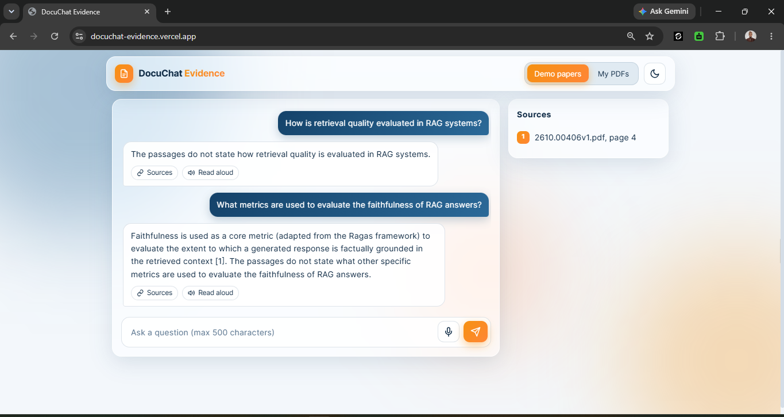
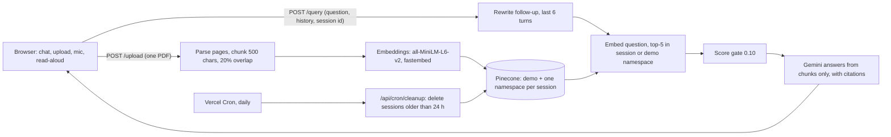
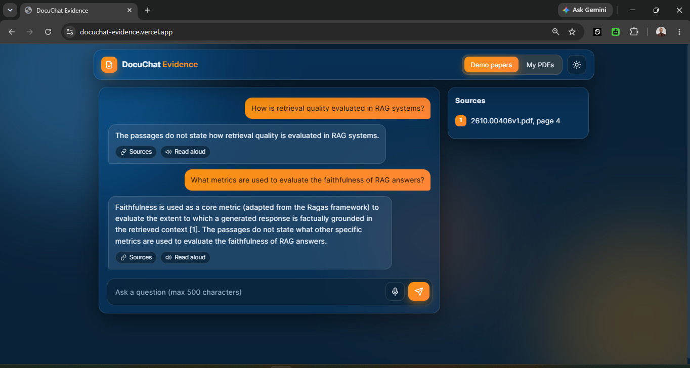
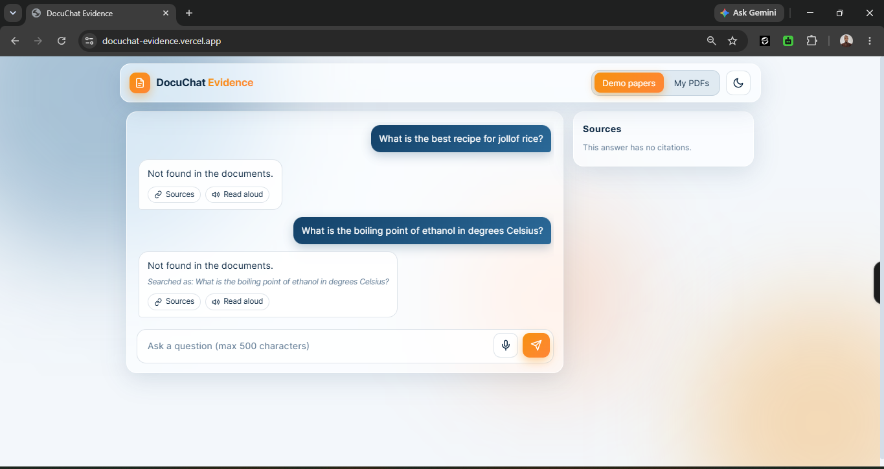
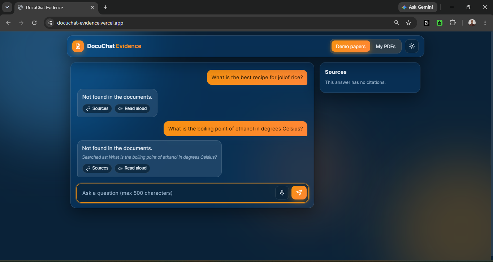
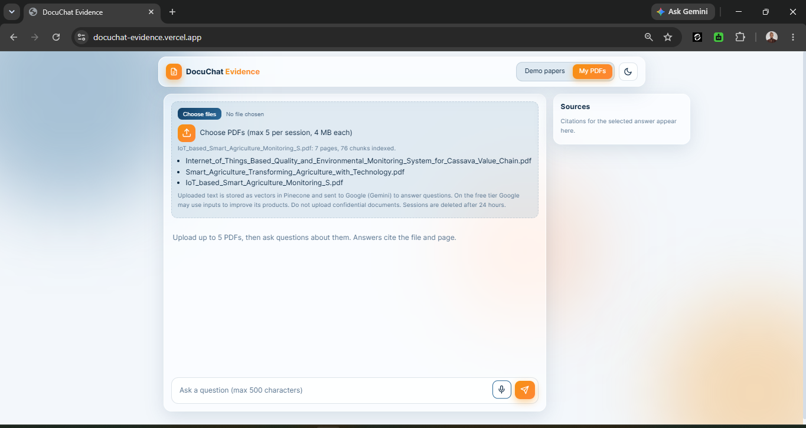
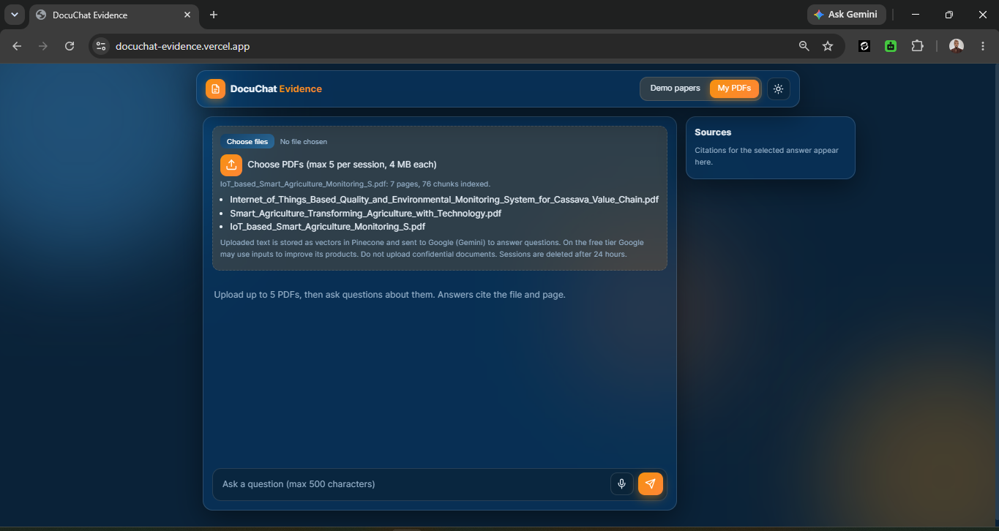

# DocuChat Evidence

RAG app that answers questions over PDFs and cites the file name and page number for every answer. Demo mode runs over 30 recent arXiv papers, or you upload up to 5 PDFs (4 MB each) into a private session. FastAPI, Pinecone, all-MiniLM-L6-v2 embeddings, Gemini, Vercel. Includes a RAG vs no-retrieval baseline comparison, with retrieval metrics and answer metrics reported separately.

**Live:** https://docuchat-evidence.vercel.app (interactive API docs at `/docs`)



> All 13 steps are built and deployed. The retrieval and answer results below come from a small question set (17 to 18 questions), so read them as a first measurement, not a benchmark. The evaluation was run before two changes made during deployment (score gate 0.2 to 0.10, and a prompt that allows partial answers), so the table describes the earlier version. See "Changes found during deployment".

## Status

- [x] 1. Scaffold and project decisions
- [x] 2. Corpus extraction and chunking experiment
- [x] 3. Embed and index the demo corpus (6,100 vectors in Pinecone)
- [x] 4. Retrieval function and retrieval metrics
- [x] 5. LLM module and no-retrieval baseline
- [x] 6. RAG generation with citations
- [x] 7. RAG vs baseline evaluation
- [x] 8. FastAPI query endpoint
- [x] 9. PDF upload with per-session namespaces
- [x] 10. Multi-turn chat with follow-up rewriting
- [x] 11. Frontend
- [x] 12. Deploy on Vercel, cron cleanup, CI
- [x] 13. Monitoring, README, screenshots

## Problem

A plain LLM answers from memory, so a reader cannot check where a claim came from, and it knows nothing about papers published after its training. This project answers from retrieved PDF passages only, and every answer cites the file and page it used. If retrieval finds nothing relevant, the app says so instead of guessing.

The main claim to test is that retrieval improves answers over the same model with no context. Step 7 reports that as a table. Retrieval quality (hit rate or precision@k) is kept separate from answer quality (correctness, citation accuracy), so a failure can be traced to the stage that caused it.

## Results so far

Same model (gemini-3.5-flash-lite), same 17 questions, answers scored by hand as correct, abstained or wrong.

| System | Correct | Abstained | Wrong |
|---|---:|---:|---:|
| No retrieval | 0/17 | 16/17 | 1/17 |
| RAG | 11/17 | 6/17 | 0/17 |

| Stage | Result |
|---|---|
| Retrieval, gold page in the top 5 (step 4, 18 questions) | 16/18 (0.89) |
| Answers correct, RAG (17 questions) | 11/17 (0.65) |
| Citation on the gold page, answered RAG rows | 11/11 |

These numbers were produced with the step 6 prompt and a score gate of 0.2. The live app now uses a gate of 0.10 and a prompt that allows partial answers. The evaluation has not been rerun. Details, limits and how the scoring was done are in step 7 below.

## Architecture



The whole app, API and static page, is one Vercel Function. The embedding model (about 87 MiB) downloads into `/tmp` on the first request after a cold start.

## Technology choices

| Tool | Purpose | Why |
|---|---|---|
| FastAPI + Pydantic | API with typed request and response models | Automatic docs at `/docs`, validation at the boundary |
| pypdf | Text extraction per page, from bytes for uploads | Pure Python, runs inside a serverless function, gives page numbers directly |
| fastembed (all-MiniLM-L6-v2, ONNX) | Embeddings, 384 dimensions, run locally | Hugging Face Inference returned 402 (no credits) and Gemini embeddings hit the free cap of 1,000 requests per day, counted per text, which cannot index 6,100 chunks or serve uploads. One model for demo and uploads |
| Pinecone serverless | Vector store, index `docuchat`, 384 dimensions, cosine | Namespaces give per-session isolation without running a database |
| gemini-3.5-flash-lite (google-genai) | LLM for RAG, rewriting and the baseline, behind one module `src/llm.py` | Free tier. One file to change if the provider changes. gemini-2.5-flash was the first choice and returned 404 ("no longer available to new users") on 2026-10-15. gemini-3.8-flash was not used because its free quota is reported at about 20 requests per day, and the evaluation needs 36 or more calls |
| Static HTML, CSS, JS | Frontend in `public/` | One page, no build step, no framework |
| uv | Dependencies and lockfile | Reproducible installs from `uv.lock` |
| Vercel | Hosting, cron cleanup | Git push deploys, cron on production deployments, `public/` served from the CDN |
| GitHub Actions | CI | ruff check, ruff format --check and pytest on every push and pull request |

The embedding change and the LLM model change from the original brief are recorded in [DECISIONS.md](DECISIONS.md).

## Repository layout

```
docuchat-evidence/
  src/
    corpus.py            download arXiv PDFs, extract text per page
    chunking.py          page-bounded chunking: chunk_page(text, size, overlap_fraction)
    embeddings.py        embed(texts, kind="document" | "query"), normalized vectors, model cache path
    store.py             get_index(): Pinecone index handle
    index_corpus.py      chunk, embed and upsert the demo corpus; --limit N, --check "question"
    retrieve.py          top-k retrieval from a namespace
    llm.py               generate(prompt, system=None): the only file that imports google-genai
    rag.py               rag_answer(question, namespace, k): retrieve, gate, answer from chunks, cite
    sessions.py          session ids, validation, limits (5 files, 4 MiB, 800 chunks per file)
    pdf_pages.py         safe_filename(), extract_pages(data, filename)
    indexing.py          build_chunks, index_pages, list_session_files
    rewrite.py           rewrite_question(question, history), last 6 turns
    cleanup.py           expired_sessions, delete_expired
    logs.py              event(): one JSON log line
    models.py            Pydantic request and response models
    app.py               FastAPI app: /health, /query, /upload, /api/cron/cleanup
  public/
    index.html, style.css, app.js
  eval/                  question set, baseline, RAG answers, scoring scripts (see steps 4 to 7)
  data/
    manifest.json        list of downloaded papers (committed)
    pdfs/                downloaded PDFs (gitignored)
    pages.jsonl          extracted text, one line per page (gitignored)
    model_cache/         embedding model files (gitignored)
  tests/                 test_api, test_upload, test_chat, test_static, test_cleanup, test_cron, test_indexing_list, test_query_logging
  screenshots/           six PNGs: chat-citations, not-found, upload-box, each in light and dark
  .github/workflows/ci.yml
  vercel.json            cron schedule
  DECISIONS.md           decisions with reasoning
  .env.example           environment variable names
  pyproject.toml, uv.lock
```

`eval/` holds: `chunk_experiment.py`, `token_check.py`, `questions.jsonl` (18 questions with gold file, gold page and, for some, answer_patterns), `retrieval_eval.py`, `sample_passages.py`, `baseline.py`, `baseline_answers.jsonl`, `rag_answers.py`, `rag_answers.jsonl`, `diagnose_notfound.py`, `diagnose_refusals.py`, `recite.py`, `make_sheet.py`, `auto_score.py`, `finish_scores.py` and `scoring_sheet.csv`.

## Setup

Requires Python 3.12 and [uv](https://docs.astral.sh/uv/). Commands are for PowerShell on Windows.

```powershell
git clone https://github.com/moshood-abdulganiyu/docuchat-evidence.git
cd docuchat-evidence
uv sync
Copy-Item .env.example .env
```

Fill in `.env`:

| Variable | Used for |
|---|---|
| `PINECONE_API_KEY` | Pinecone access |
| `PINECONE_INDEX` | Index name, `docuchat` |
| `GEMINI_API_KEY` | LLM calls |
| `LLM_MODEL` | `gemini-3.5-flash-lite` |

Create the Pinecone index once (384 dimensions, cosine):

```powershell
uv run python -c "from pinecone import Pinecone, ServerlessSpec; import os; from dotenv import load_dotenv; load_dotenv(); pc = Pinecone(api_key=os.environ['PINECONE_API_KEY']); pc.create_index(name='docuchat', dimension=384, metric='cosine', spec=ServerlessSpec(cloud='aws', region='us-east-1')); print(pc.describe_index('docuchat'))"
```

Index the demo corpus, then run the app (the page is at http://127.0.0.1:8000/ and the docs at `/docs`):

```powershell
uv run python -m src.corpus download
uv run python -m src.corpus extract
uv run python -m src.index_corpus
uv run uvicorn src.app:app --reload
```

Checks, one per line:

```powershell
uv run ruff check .
uv run ruff format --check .
uv run pytest -q
```

## Step 2: build the corpus and run the chunking experiment

```powershell
uv run python -m src.corpus download
uv run python -m src.corpus extract
uv run python -m eval.chunk_experiment
```

**Corpus.** `download` queries the arXiv API for the newest papers matching "retrieval augmented generation" and "evaluation" (up to 30) and saves each PDF to `data/pdfs/`. It waits 3 seconds between downloads because arXiv asks for no more than one request per 3 seconds. The exact papers are listed in `data/manifest.json`. Recent papers are a deliberate choice: a model without retrieval is more likely to miss them, which makes the later comparison more informative.

**Extraction.** `extract` reads every PDF with `pypdf`, collapses whitespace, and drops pages with fewer than 50 characters (blank pages, figure-only pages). Each remaining page becomes one line in `data/pages.jsonl` with the file name, page number and text. The run produced 538 pages. The page number is the PDF page index starting at 1, which can differ from the number printed on the page. Citations use the PDF index so a reader can jump to it in a viewer.

## Chunking decision

**Strategy.** Fixed-size character windows with overlap, with two rules:

1. A chunk never crosses a page boundary, so every chunk maps to exactly one page and every citation is exact. The cost is that a sentence running across a page break is split.
2. When a window would end mid-sentence, the cut moves back to the last sentence end ("`. `") in the final 40% of the window, if there is one.

**Experiment 1: chunk structure.** Four configurations on the 538 extracted pages. This measures chunk shape only, not retrieval quality.

| Size (chars) | Overlap | Chunks | Mean length | Under 200 chars | Ends mid-sentence |
|---:|---:|---:|---:|---:|---:|
| 500 | 10% | 5,388 | 425 | 1.9% | 20.0% |
| 500 | 20% | 6,100 | 427 | 1.2% | 19.4% |
| 800 | 10% | 3,332 | 682 | 1.3% | 18.2% |
| 800 | 20% | 3,713 | 688 | 0.3% | 17.1% |

The last chunk on each page ends at the page boundary, so it counts as mid-sentence whenever the page does not end on a full stop. That accounts for at most 10.0%, 8.8%, 16.1% and 14.5% of the chunks in the four rows. The avoidable mid-sentence rate is therefore at least 10.0%, 10.6%, 2.1% and 2.6%. On this measure 800/20% looked best, and it was chosen provisionally.

**Experiment 2: token limit.** all-MiniLM-L6-v2 reads at most 256 tokens. The first choice assumed 800 characters is about 200 tokens. Counting tokens with the model's own tokenizer on every chunk showed otherwise, because equations, tables and reference lists use more tokens per character than prose.

| Size (chars) | Overlap | Chunks | Mean tokens | 95th percentile | Max | Over 256 tokens |
|---:|---:|---:|---:|---:|---:|---:|
| 500 | 20% | 6,100 | 113 | 191 | 377 | 77 (1.3%) |
| 600 | 20% | 5,039 | 136 | 226 | 452 | 156 (3.1%) |
| 700 | 20% | 4,256 | 159 | 265 | 527 | 253 (5.9%) |
| 800 | 20% | 3,713 | 181 | 299 | 602 | 418 (11.3%) |

Text past the 256-token limit is not represented in the vector, so those chunks cannot be retrieved by their tail. The gate was 3% of chunks over the limit. 800 fails at 11.3%, and the planned fallback of 700 also fails at 5.9%. 600 misses by 0.1 points.

**Choice: 500 characters, 20% overlap.** It is the largest size that passes the 3% gate. The cost is 6,100 vectors instead of 3,713, and at least 10.6% avoidable mid-sentence cuts against 2.6% for 800/20%, because the sentence-snapping window is only 200 characters wide.
**What will confirm or reverse this.** The planned 600/20% comparison was not run. With 18 questions one question is 5.6 points, too coarse to separate two sizes that differ by about 1 to 2 questions. 500/20% stays, on the token-limit result above. Step 4 reports hit rate for 500/20% only (see below).

## Step 3: embed and index the demo corpus

```powershell
uv run python -m src.index_corpus
uv run python -m src.index_corpus --check "How is retrieval quality evaluated in RAG systems?"
```

Each page is chunked at 500 characters with 20% overlap. Each chunk gets the id `file:pPAGE:cIDX` and is embedded locally, then upserted in batches of 64 into the namespace `demo` with metadata: file, page, chunk index and text. The first run downloads the model into `data/model_cache/`. Pinecone reports 6,100 vectors, 384 dimensions, cosine, matching the chunk count.

`--check` embeds a question as a query and prints the top 3 hits with score, file and page. It is a smoke test, not a metric. Hit rate comes in step 4.

To rerun the token check, find the tokenizer file and pass its path:

```powershell
Get-ChildItem data\model_cache -Recurse -Filter tokenizer.json | Select-Object -First 1 -ExpandProperty FullName
uv run python -m eval.token_check "<path to tokenizer.json>"
```

To re-index after changing the chunk size, delete the old vectors first so old ids do not sit beside the new ones:

```powershell
uv run python -c "from src.store import get_index; get_index().delete(delete_all=True, namespace='demo')"
uv run python -m src.index_corpus
```

## Step 4: retrieval and hit rate

```powershell
uv run python -m src.retrieve "How is retrieval quality evaluated in RAG systems?" -k 5
uv run python -m eval.retrieval_eval
```

`src/retrieve.py` embeds the question as a query and returns the top-k chunks from a Pinecone namespace (the namespace is a parameter, used for session isolation in step 9). `eval/questions.jsonl` holds 18 questions, each written from a passage sampled from a different paper (`eval/sample_passages.py`, seed 7, reference-list pages skipped).

A hit means a retrieved chunk is from the gold file and a gold page. Gold pages are every page of the gold paper that contains the answer string (`answer_patterns`), because headline facts repeat in the abstract, introduction, results and tables. For one question (q13) the contents page was excluded.

| Run | k=3 file+page | k=5 file+page | file only (k=3 and 5) |
|---|---:|---:|---:|
| First run, one gold page per question | 10/18 (0.56) | 11/18 (0.61) | 17/18 (0.94) |
| Gold pages from answer strings | 15/18 (0.83) | 16/18 (0.89) | 17/18 (0.94) |

The change between the two rows is a labelling fix, not a retrieval improvement. Five questions (q02, q05, q07, q13, q14) gained extra valid pages after I read the first-run misses. That can only raise the score, so both rows are reported.

Misses at k=5: q01 (answer is an affiliation line, no chunk from the paper returned) and q06 (right paper, but the top 5 chunks came from other pages; the p4 chunk naming the model was not returned). q04 hits only at rank 5.

Limits of this number: 18 questions, so one question is 5.6 points; a hit means the right page was returned, not that the returned chunk contains the answer; the questions were written by one person. Step 6 found a concrete case of the second limit (q13, below).

## Step 5: LLM module and no-retrieval baseline

```powershell
uv run python -m eval.baseline
```

`src/llm.py` holds one function, `generate(prompt, system=None)`. It calls the model named in `LLM_MODEL` at temperature 0 and retries rate-limit and server errors (429, 500, 503) with a delay that starts at 5 seconds and doubles, up to 4 retries. No other file imports google-genai, so a provider change touches this file only.

`eval/baseline.py` sends each of the 18 questions to the model with no context. The system prompt asks for a direct, concise answer from the model's own knowledge, and to say it does not know when it does not. Each answer is saved to `eval/baseline_answers.jsonl` with the question id, question, answer, model name and timestamp. The script waits 7 seconds between calls and skips ids that are already saved, so a rate-limit stop can be resumed by running it again.

A baseline that says "I do not know." is behaving correctly for papers newer than its training data. Step 7 therefore scores each answer as correct, abstained or wrong, so that abstaining is not counted as a wrong guess.

## Step 6: RAG generation with citations

```powershell
uv run python -m src.rag "How is retrieval quality evaluated in RAG systems?"
uv run python -m eval.rag_answers
```

`src/rag.py` has `rag_answer(question, namespace="demo", k=5)`:

1. Retrieve the top 5 chunks and drop any scoring under `MIN_SCORE`. It was 0.2 when the evaluation was run and is 0.10 since step 12. If none are left, return "Not found in the documents." without calling the model, with `reason` set to `gate`.
2. Otherwise number the remaining chunks `[1]` to `[5]` in the prompt, each with its file and page. The system prompt allows only the passages as a source and requires a passage number after every claim. When the passages contain nothing that answers the question, the model must reply with the exact text `NOT_FOUND`, recorded with `reason` set to `model`. During the evaluation, the prompt required `NOT_FOUND` whenever the passages did not fully answer the question. Since step 12 it may answer the supported part and name what is missing. An empty reply is recorded as `empty`.
3. The code reads the cited numbers (forms `[1]`, `[1][3]` and `[1, 5]`) and maps each to a file and page, one entry per distinct page. A number outside the range is recorded as `invalid_citations`, and an answer with no numbers is flagged `uncited`.

Citing by number means the model cannot invent a file name or page: the citation list comes from the chunks it was shown. A first version of the parser missed the `[1, 5]` form and listed a page twice when two chunks came from it. Both were fixed, and the saved answers were recomputed offline with `eval/recite.py`.

`eval/rag_answers.py` runs the same 18 questions and saves each result to `eval/rag_answers.jsonl` with the answer, citations and the retrieved ids, files, pages and scores, so retrieval and answers can be scored separately.

**Smoke tests (one question each, not a calibration).**

| Question | Top 5 scores | Result |
|---|---|---|
| How is retrieval quality evaluated in RAG systems? | 0.602 to 0.649 | Cited answer, [3] = 2610.02926v1.pdf p.8 |
| What is the best recipe for jollof rice? | 0.247 to 0.290 | "Not found in the documents." |

The off-topic scores are above the 0.2 gate, so that refusal came from the model's `NOT_FOUND` reply, not from the score gate. The gate did nothing in this test.

**Why six questions came back "not found".** The first run gave 12 answers and 6 refusals out of 18 questions (q01, q03, q06, q07, q13, q16). Rerunning those six with the `reason` field (`eval/diagnose_notfound.py`) showed that all six were `model` refusals: every one had 5 of 5 chunks above the score gate (top-5 scores 0.491 to 0.730), and none answered on the rerun. The score gate was not the cause. `eval/diagnose_refusals.py` then checked whether the gold answer string was in the retrieved chunks:

| Question | What the check found |
|---|---|
| q01 | Gold paper not retrieved at all (a step 4 miss). Refusal is correct. |
| q06 | Gold file in all 5 chunks, but the answer phrase is in none (a step 4 miss). Refusal is correct. |
| q13 | Gold pages 8 and 20 returned, but none of the three model names is in any chunk. Step 4 counted this as a hit. Refusal is correct. |
| q07 | The answer string 0.798 is in a retrieved chunk and the model still refused. Cause not found. |
| q03, q16 | No answer string recorded, so the check could not run. Cause not found. |

So 3 of the 6 refusals are correct (the answer never reached the model), and 3 are unexplained. I stopped the diagnosis there and did not change the prompt. A later finding (see "Changes found during deployment") shows the all-or-nothing prompt rule made the model refuse a question whose answer was only partly in the passages. That may explain some of the three, but I did not check.

## Step 7: RAG vs no-retrieval baseline

Same model, same questions, scored on 17 questions. q05 is excluded: its question is ambiguous, because the paper's no-retrieval table row for the 8B Llama model has five values and the abstract ties one of them to the multi-domain evaluation.

| System | Correct | Abstained | Wrong |
|---|---:|---:|---:|
| No retrieval | 0/17 | 16/17 | 1/17 |
| RAG | 11/17 | 6/17 | 0/17 |

Retrieval and answers are reported separately:

| Stage | Result |
|---|---|
| Retrieval, gold page in the top 5 (18 questions) | 16/18 (0.89) |
| Answers correct, RAG (17 questions) | 11/17 (0.65) |
| Citation on the gold page, answered RAG rows | 11/11 |

The gap between 0.89 retrieval and 0.65 correct answers is the 6 refusals described in step 6. RAG gave no wrong answers. The baseline gave one wrong answer (q09) and abstained on the rest.

**How the scoring was done.** `eval/make_sheet.py` builds `eval/scoring_sheet.csv` with every "I do not know" baseline answer and every RAG "not found" prefilled as abstained. `eval/auto_score.py` marked a RAG answer correct when it contained the gold answer string, and a citation as good when the cited page's text did. That covered 2 of the 11 answered rows (q02, q14). The other 9 answers were judged by hand against the cited page, and `eval/finish_scores.py` applied the judgments and printed the table. The baseline answer for q09 was also judged by hand.

**How to read this.**
- The baseline abstained on 16 of 17 because the questions name specific recent papers it cannot know. The table shows that retrieval lets the model answer at all. It does not show that retrieval beats a model that already knows the topic.
- Citation accuracy means the cited page is the page the question was written from. That is weaker than checking every claim in the answer.
- 17 questions, so one question is 5.9 points. One person wrote the questions and scored the answers.
- Both systems use gemini-3.5-flash-lite, a small model. A larger model may know more without retrieval.
- The table was produced before the step 12 changes to the score gate and the prompt, and has not been rerun.

## Step 8: query API

```powershell
uv run uvicorn src.app:app --reload
```

Open http://127.0.0.1:8000/docs for the interactive docs.

| Endpoint | Purpose |
|---|---|
| `GET /health` | Returns `{"status": "ok"}` |
| `POST /query` | Body: `question` (1 to 500 characters, whitespace trimmed), `k` (1 to 10, default 5), optional `session_id`, optional `history` (see steps 9 and 10). Returns `answer`, `found`, `reason`, `citations` (`n`, `file`, `page`), `uncited`, `retrieved` (`id`, `score`, `file`, `page`), `rewritten_question` |
| `POST /upload` | Multipart: `file`, optional `session_id` (see step 9) |

Errors: invalid input returns 422. A Gemini rate limit (status 429) returns 503 with a short message. Any other failure returns 502 with a generic message. The full exception goes to the server log only.

## Step 9: PDF upload with per-session namespaces

`POST /upload` takes one PDF per request (multipart field `file`, optional form field `session_id`). With no session id the server creates one and returns it. The page keeps it in sessionStorage and sends it with every later upload and question.

- **Session id.** `sess_<10-digit unix time>_<16 hex>`, checked with a strict regex. `demo` is rejected as a session id, so a caller cannot pick the demo namespace or any other namespace by crafting a value.
- **Namespaces.** Each session is one Pinecone namespace. `/query` searches the namespace named by `session_id`, or `demo` when there is none.
- **Limits.** 4 MiB per file, 5 files per session, 800 chunks per file (a guess, not measured).
- **Check order.** `.pdf` name, bounded read of 4 MiB (413), `%PDF` header, session id (422), duplicate name or 5 files already (409), parse (422, includes scanned PDFs with no text and encrypted PDFs), chunk cap (422), index (502).
- **Parsing.** In memory with pypdf. Nothing is written to disk.
- **Response.** Session id, file name, pages, chunks and files in the session.

One bug found here: `chunk_page` takes overlap as a fraction, and passing 20 instead of 0.20 produced 3,439 chunks for one file. Fixed in `src/indexing.py` (`OVERLAP_PCT = 0.20`).

## Step 10: multi-turn chat with follow-up rewriting

The browser sends the last 6 messages as `history`, and the server truncates to the last 6 again. `rewrite_question(question, history)` asks Gemini to turn a follow-up into a standalone question, which is what gets embedded and searched. With no history there is no extra call. If the rewrite call fails, the original question is used. The response carries `rewritten_question`, and the page shows it as "Searched as".

Cost: one extra Gemini call per follow-up. Rewrite quality has not been measured.

## Step 11: frontend

Static HTML, CSS and JS in `public/`, no framework. It has a chat thread, a citations panel, an upload box with a progress bar, a demo/upload toggle, a mic button (Web Speech API) and a read-aloud button (speechSynthesis). Answers are rendered with `textContent`, so model output is never injected as HTML. Switching mode clears the history sent to the server but not the visible thread. Uploads are sequential. Mic works only in Chrome and Edge.

## Step 12: deployment, cron cleanup, CI

**Hosting.** Vercel finds `src/app.py` as the FastAPI entrypoint. The whole app is one function. `public/` is served from the CDN, so the `StaticFiles` mount in `src/app.py` runs only when the `VERCEL` environment variable is unset. Environment variables in Vercel: `PINECONE_API_KEY`, `PINECONE_INDEX`, `GEMINI_API_KEY`, `LLM_MODEL`, `CRON_SECRET`, `MODEL_CACHE_DIR=/tmp/model_cache`, `HF_HOME=/tmp/hf`.

**Model file.** The model (91,104,077 bytes, about 87 MiB) is downloaded into `/tmp` on the first request after a cold start, because the deploy folder is read-only. That request is slow. The time was not measured.

**Cleanup.** `vercel.json` schedules `GET /api/cron/cleanup` daily at 03:00 UTC. The route requires `Authorization: Bearer <CRON_SECRET>`, lists namespaces, and deletes those whose names match the session pattern and are older than 24 hours. `demo` never matches the pattern. With a daily schedule a session can live up to about 48 hours.

**CI.** `.github/workflows/ci.yml` runs `uv sync --frozen`, `ruff check`, `ruff format --check` and `pytest -q` on Python 3.12.

**Checked on the deployed URL.** 5 files accepted and a 6th rejected (409). Two sessions are isolated. The cron route returns 401 without the secret and 200 with it. A fake namespace with a 2001 timestamp was deleted and `demo` was kept.

**Limits checked against current docs (2026-10-29).** Vercel request and response body: 4.5 MB (so the 4 MiB upload limit stays). Python function bundle: 500 MB uncompressed. Cron runs on production deployments only. Pinecone Starter plan: 100 namespaces per index, 2 GB storage, 2M write units and 1M read units per month. Two points come from third-party pages and were not confirmed in the Vercel dashboard or docs: a 300 s function duration on Hobby with Fluid compute, and daily-only cron on Hobby.

## Changes found during deployment

Four problems appeared only on the live site. Each was found in the Vercel logs or with one request, then fixed.

1. **Read-only filesystem.** Every question returned "The answer service failed." The log showed fastembed failing with "Read-only file system" while downloading the model. Fix: the model cache moves to `/tmp`. The first fix assumed the `VERCEL` variable and still failed. The second checks whether the folder is writable.
2. **Pinecone list objects.** The fourth upload failed in every session with `AttributeError: 'ListItem' object has no attribute 'rsplit'`. The SDK returns objects with `.id`, and the code treated them as strings. The tests faked the whole function, so the real code never ran. Fix: read `.id`, and a test now runs the real function against a fake that returns objects.
3. **Score gate.** A short CV PDF returned "Not found" for a leadership question. `/query` showed `reason: "gate"` with a best score of 0.198 against a gate of 0.2. The gate is now 0.10. The off-topic jollof rice question scored 0.247 to 0.290 against the arXiv papers, so the gate could not separate on-topic from off-topic anyway. The model's `NOT_FOUND` reply is the real guard. 0.10 is a guess based on one short document.
4. **All-or-nothing prompt.** "What is the graduation date and the final grade?" refused although the chunk with the CGPA was among the 5 retrieved (the question "What is the CGPA?" returned `4.59/5.00 [1]`). The prompt said to reply `NOT_FOUND` unless the passages answered the question. Now it may answer the supported part and name what is missing. On the live site the answer cited the grade and said the date is not stated. Checked on one document.

## Monitoring (step 13)

Logs are JSON lines written by `src/logs.py` and read in the Vercel logs. They hold counts, scores, timings and error types. Question text, answer text, file names and session ids are never logged. Two tests (`tests/test_query_logging.py`) check that the question and answer text do not appear in the events.

| Event | Written by | Fields |
|---|---|---|
| `request` | middleware, for `/query` and `/upload` | `path`, `status`, `ms` (whole request) |
| `query` | `/query`, on success | `mode` (demo or session), `found`, `reason`, `k`, `retrieved`, `top_score`, `cited`, `uncited`, `rewritten`, `rewrite_ms`, `rag_ms` |
| `query_error` | `/query`, on failure | `mode`, `error_type` (exception class name), `error_code` (integer or null) |

To find them, search the Vercel logs for `"event": "query"` or `"event": "query_error"`.

**Latency seen on the live site.** Four demo questions took 1,385, 1,458, 2,278 and 2,494 ms end to end. For one follow-up, the rewrite took 604 ms and retrieval plus the answer took 853 ms, so the rewrite was 41% of that request. Four samples are not a benchmark, and I did not record which requests were cold starts. Cold-start time was not measured.

## Screenshots

Demo mode, light and dark themes. Each pair shows the same state.

| | Light | Dark |
|---|---|---|
| A cited answer with the sources panel |  |  |
| A question the documents cannot answer |  |  |
| Upload box after three PDFs |  |  |

## Known limits so far

- The answer results rest on 17 questions scored by one person (see step 7). Retrieval hit rate is on 18 questions. Both predate the step 12 changes to the score gate and prompt.
- 6 of 17 RAG answers were refusals. 3 are explained (answer text not in the retrieved chunks) and 3 (q03, q07, q16) are not. The prompt change may explain some. Not checked.
- Page-level hit rate overstates how often the answer reaches the model: q13 counted as a hit although no retrieved chunk contained the answer.
- `MIN_SCORE` is 0.10 and uncalibrated, set from one short document. The partial-answer prompt was checked on one question.
- The baseline comparison is weak by design: the questions name papers a model cannot know without retrieval.
- Both systems use a small model, gemini-3.5-flash-lite.
- `pypdf` drops spaces and splits hyphenated words on some pages (retrieved passages showed "factualgrounding", "fortesting" and "guide- lines"). Not yet quantified or fixed. Changing extraction means re-indexing.
- pypdf glues table cells together ("0.7790.594", "86.4098.15100.00"), so numeric tables embed and match poorly.
- Two-column layouts can interleave columns. Not yet checked, and likely common in arXiv papers.
- Some pages contain garbled characters ("•", "Query→Top-k"). Cause not yet found (PDF or extraction).
- Scanned PDFs without a text layer produce no pages, and uploads of them are rejected (422).
- Reference-list pages are indexed and can take top-k slots. Not measured as a cause of any miss here.
- The corpus is whatever the arXiv query returned on the day it was run. `data/manifest.json` records which papers were used.
- **Privacy.** Text from uploaded PDFs and from questions is sent to Google (Gemini free tier), and Google may use free-tier inputs to improve its products. Do not upload documents you cannot share. The upload box should carry the same notice (verify in the page).
- **Access control.** The session id is the only access control. Anyone holding it can query and upload to that session. `/query` and `/upload` have no rate limiting or authentication, so anyone with the URL can use the Gemini free quota.
- **Namespace cap.** The Pinecone free plan allows 100 namespaces per index, and `demo` uses one. A burst of about 99 new sessions in a day could block uploads until the next cleanup. No cap is built.
- **Cleanup delay.** Cleanup runs daily, so a session can live up to about 48 hours.
- **Cold start.** The first request after a cold start downloads the model. Time not measured.
- **Eventual consistency.** Pinecone list is eventually consistent: rapid uploads can exceed 5 files or repeat a file name.
- **Timeouts.** A rate-limited request can wait up to 75 s inside `llm.py` retries (5 + 10 + 20 + 40 s) before the API answers 503. Not checked against the function duration on this plan.
- **Rewrite cost and quality.** Each follow-up adds one Gemini call, and follow-up quality is not measured.
- **Frontend.** Switching mode clears history but not the visible thread. Uploads are sequential. Mic works only in Chrome and Edge. Not tested on mobile.
- Error mapping reads a `.code` attribute on the exception. It depends on how google-genai reports errors.
- The question limit (500 characters), k limit (10) and chunk cap per file (800) are guesses, not tuned.
- `src/index_corpus.py` still has its own indexing loop and constants and has not been moved onto `index_pages`.
- Starlette warns that `TestClient` with httpx is deprecated. Not acted on.

## Decisions log

See [DECISIONS.md](DECISIONS.md) for the full list, including the embedding change, the chunk size change, the LLM model change, the evaluation choices and the deployment decisions.

## License

MIT. See [LICENSE](LICENSE).
