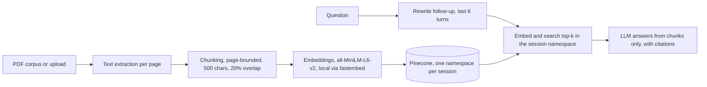

# DocuChat Evidence

RAG app that answers questions over PDFs and cites the file name and page number for every answer. Demo mode runs over 30 recent arXiv papers, or you upload up to 5 PDFs (4 MB each). FastAPI, Pinecone, all-MiniLM-L6-v2 embeddings, Vercel. Includes a RAG vs no-retrieval baseline comparison, with retrieval metrics and answer metrics reported separately.

> Work in progress. This README covers steps steps 1 to 4. Anything marked "planned" is not built yet, and no answer quality numbers exist yet.

## Status

- [x] 1. Scaffold and project decisions
- [x] 2. Corpus extraction and chunking experiment
- [x] 3. Embed and index the demo corpus (6,100 vectors in Pinecone)
- [x] 4. Retrieval function and retrieval metrics
- [ ] 5. LLM module and no-retrieval baseline
- [ ] 6. RAG generation with citations
- [ ] 7. RAG vs baseline evaluation
- [ ] 8. FastAPI query endpoint
- [ ] 9. PDF upload with per-session namespaces
- [ ] 10. Multi-turn chat with follow-up rewriting
- [ ] 11. Frontend
- [ ] 12. Deploy, cron cleanup, CI
- [ ] 13. Monitoring, README, screenshots

## Problem

A plain LLM answers from memory, so a reader cannot check where a claim came from, and it knows nothing about papers published after its training. This project answers from retrieved PDF passages only, and every answer cites the file and page it used. If retrieval finds nothing relevant, the app says so instead of guessing.

The main claim to test is that retrieval improves answers over the same model with no context. Step 7 reports that as a table. Retrieval quality (hit rate or precision@k) is kept separate from answer quality (correctness, citation accuracy), so a failure can be traced to the stage that caused it.

## Architecture



Built so far: the boxes from the PDF corpus through Pinecone, for the demo namespace only. Planned: everything on the question side, per-session namespaces for uploads, and the LLM. Step 4 adds embed and search top-k in the namespace.

## Technology choices

| Tool | Purpose | Why |
|---|---|---|
| FastAPI + Pydantic | API with typed request and response models | Automatic docs at `/docs`, validation at the boundary (planned, step 8) |
| pypdf | Text extraction per page | Pure Python, runs inside a serverless function, gives page numbers directly |
| fastembed (all-MiniLM-L6-v2, ONNX) | Embeddings, 384 dimensions, run locally | Hugging Face Inference returned 402 (no credits) and Gemini embeddings hit the free cap of 1,000 requests per day, counted per text, which cannot index 6,100 chunks or serve uploads. One model for demo and uploads |
| Pinecone serverless | Vector store, index `docuchat`, 384 dimensions, cosine | Namespaces give per-session isolation without running a database |
| gemini-2.5-flash | LLM for RAG and the baseline, behind one module `src/llm.py` | Free tier. One file to change if the provider changes (planned, step 5) |
| uv | Dependencies and lockfile | Reproducible installs from `uv.lock` |
| Vercel | Deployment and cron cleanup | Planned, step 12 |

The embedding change from the original brief (Hugging Face API to local fastembed) is recorded in [DECISIONS.md](DECISIONS.md).

## Repository layout

```
docuchat-evidence/
  src/
    corpus.py            download arXiv PDFs, extract text per page
    chunking.py          page-bounded chunking: chunk_page(text, size, overlap_pct)
    embeddings.py        embed(texts, kind="document" | "query"), normalized vectors
    store.py             get_index(): Pinecone index handle
    index_corpus.py      chunk, embed and upsert the demo corpus; --limit N, --check "question"
    retrieve.py          top-k retrieval from a namespace
  eval/
    chunk_experiment.py  compares chunking configurations by structure
    token_check.py       counts MiniLM tokens per chunk against the 256-token limit
    questions.jsonl
    retrieval_eval.py
    sample_passages.py
  data/
    manifest.json        list of downloaded papers (committed)
    pdfs/                downloaded PDFs (gitignored)
    pages.jsonl          extracted text, one line per page (gitignored)
    model_cache/         embedding model files (gitignored)
  api/ public/ screenshots/   empty until later steps
  DECISIONS.md           decisions with reasoning
  .env.example           environment variable names
  pyproject.toml, uv.lock
```

## Setup

Requires Python 3.12 and [uv](https://docs.astral.sh/uv/). Commands are for PowerShell on Windows.

```powershell
git clone https://github.com/moshood-abdulganiyu/docuchat-evidence.git
cd docuchat-evidence
uv sync
Copy-Item .env.example .env
```

Fill in `.env`:

| Variable | Used for |
|---|---|
| `PINECONE_API_KEY` | Pinecone access |
| `PINECONE_INDEX` | Index name, `docuchat` |
| `GEMINI_API_KEY` | LLM calls (step 5 onward) |
| `LLM_MODEL` | `gemini-2.5-flash` |

Create the Pinecone index once (384 dimensions, cosine):

```powershell
uv run python -c "from pinecone import Pinecone, ServerlessSpec; import os; from dotenv import load_dotenv; load_dotenv(); pc = Pinecone(api_key=os.environ['PINECONE_API_KEY']); pc.create_index(name='docuchat', dimension=384, metric='cosine', spec=ServerlessSpec(cloud='aws', region='us-east-1')); print(pc.describe_index('docuchat'))"
```

## Step 2: build the corpus and run the chunking experiment

```powershell
uv run python -m src.corpus download
uv run python -m src.corpus extract
uv run python -m eval.chunk_experiment
```

**Corpus.** `download` queries the arXiv API for the newest papers matching "retrieval augmented generation" and "evaluation" (up to 30) and saves each PDF to `data/pdfs/`. It waits 3 seconds between downloads because arXiv asks for no more than one request per 3 seconds. The exact papers are listed in `data/manifest.json`. Recent papers are a deliberate choice: a model without retrieval is more likely to miss them, which makes the later comparison more informative.

**Extraction.** `extract` reads every PDF with `pypdf`, collapses whitespace, and drops pages with fewer than 50 characters (blank pages, figure-only pages). Each remaining page becomes one line in `data/pages.jsonl` with the file name, page number and text. The run produced 538 pages. The page number is the PDF page index starting at 1, which can differ from the number printed on the page. Citations use the PDF index so a reader can jump to it in a viewer.

## Chunking decision

**Strategy.** Fixed-size character windows with overlap, with two rules:

1. A chunk never crosses a page boundary, so every chunk maps to exactly one page and every citation is exact. The cost is that a sentence running across a page break is split.
2. When a window would end mid-sentence, the cut moves back to the last sentence end ("`. `") in the final 40% of the window, if there is one.

**Experiment 1: chunk structure.** Four configurations on the 538 extracted pages. This measures chunk shape only, not retrieval quality.

| Size (chars) | Overlap | Chunks | Mean length | Under 200 chars | Ends mid-sentence |
|---:|---:|---:|---:|---:|---:|
| 500 | 10% | 5,388 | 425 | 1.9% | 20.0% |
| 500 | 20% | 6,100 | 427 | 1.2% | 19.4% |
| 800 | 10% | 3,332 | 682 | 1.3% | 18.2% |
| 800 | 20% | 3,713 | 688 | 0.3% | 17.1% |

The last chunk on each page ends at the page boundary, so it counts as mid-sentence whenever the page does not end on a full stop. That accounts for at most 10.0%, 8.8%, 16.1% and 14.5% of the chunks in the four rows. The avoidable mid-sentence rate is therefore at least 10.0%, 10.6%, 2.1% and 2.6%. On this measure 800/20% looked best, and it was chosen provisionally.

**Experiment 2: token limit.** all-MiniLM-L6-v2 reads at most 256 tokens. The first choice assumed 800 characters is about 200 tokens. Counting tokens with the model's own tokenizer on every chunk showed otherwise, because equations, tables and reference lists use more tokens per character than prose.

| Size (chars) | Overlap | Chunks | Mean tokens | 95th percentile | Max | Over 256 tokens |
|---:|---:|---:|---:|---:|---:|---:|
| 500 | 20% | 6,100 | 113 | 191 | 377 | 77 (1.3%) |
| 600 | 20% | 5,039 | 136 | 226 | 452 | 156 (3.1%) |
| 700 | 20% | 4,256 | 159 | 265 | 527 | 253 (5.9%) |
| 800 | 20% | 3,713 | 181 | 299 | 602 | 418 (11.3%) |

Text past the 256-token limit is not represented in the vector, so those chunks cannot be retrieved by their tail. The gate was 3% of chunks over the limit. 800 fails at 11.3%, and the planned fallback of 700 also fails at 5.9%. 600 misses by 0.1 points.

**Choice: 500 characters, 20% overlap.** It is the largest size that passes the 3% gate. The cost is 6,100 vectors instead of 3,713, and at least 10.6% avoidable mid-sentence cuts against 2.6% for 800/20%, because the sentence-snapping window is only 200 characters wide.
**What will confirm or reverse this.** The planned 600/20% comparison was not run. With 18 questions one question is 5.6 points, too coarse to separate two sizes that differ by about 1 to 2 questions. 500/20% stays, on the token-limit result above. Step 4 reports hit rate for 500/20% only (see below).

## Step 3: embed and index the demo corpus

```powershell
uv run python -m src.index_corpus
uv run python -m src.index_corpus --check "How is retrieval quality evaluated in RAG systems?"
```

Each page is chunked at 500 characters with 20% overlap. Each chunk gets the id `file:pPAGE:cIDX` and is embedded locally, then upserted in batches of 64 into the namespace `demo` with metadata: file, page, chunk index and text. The first run downloads the model into `data/model_cache/`. Pinecone reports 6,100 vectors, 384 dimensions, cosine, matching the chunk count.

`--check` embeds a question as a query and prints the top 3 hits with score, file and page. It is a smoke test, not a metric. Hit rate comes in step 4.

To rerun the token check, find the tokenizer file and pass its path:

```powershell
Get-ChildItem data\model_cache -Recurse -Filter tokenizer.json | Select-Object -First 1 -ExpandProperty FullName
uv run python -m eval.token_check "<path to tokenizer.json>"
```

To re-index after changing the chunk size, delete the old vectors first so old ids do not sit beside the new ones:

`powershell
uv run python -c "from src.store import get_index; get_index().delete(delete_all=True, namespace='demo')"
uv run python -m src.index_corpus
`

## Step 4: retrieval and hit rate

```powershell
uv run python -m src.retrieve "How is retrieval quality evaluated in RAG systems?" -k 5
uv run python -m eval.retrieval_eval
```

`src/retrieve.py` embeds the question as a query and returns the top-k chunks from a Pinecone namespace (the namespace is a parameter, for step 9). `eval/questions.jsonl` holds 18 questions, each written from a passage sampled from a different paper (`eval/sample_passages.py`, seed 7, reference-list pages skipped).

A hit means a retrieved chunk is from the gold file and a gold page. Gold pages are every page of the gold paper that contains the answer string (`answer_patterns`), because headline facts repeat in the abstract, introduction, results and tables. For one question (q13) the contents page was excluded.

| Run | k=3 file+page | k=5 file+page | file only (k=3 and 5) |
|---|---:|---:|---:|
| First run, one gold page per question | 10/18 (0.56) | 11/18 (0.61) | 17/18 (0.94) |
| Gold pages from answer strings | 15/18 (0.83) | 16/18 (0.89) | 17/18 (0.94) |

The change between the two rows is a labelling fix, not a retrieval improvement. Five questions (q02, q05, q07, q13, q14) gained extra valid pages after I read the first-run misses. That can only raise the score, so both rows are reported.

Misses at k=5: q01 (answer is an affiliation line, no chunk from the paper returned) and q06 (right paper, but the top 5 chunks came from other pages; the p4 chunk naming the model was not returned). q04 hits only at rank 5.

Limits of this number: 18 questions, so one question is 5.6 points; a hit means the right page was returned, not that the returned chunk contains the answer; the questions were written by one person.

## Known limits so far

- No answer quality result exists yet. Retrieval hit rate is measured on 18 questions only (see step 4).
- `pypdf` drops spaces and splits hyphenated words on some pages (retrieved passages showed "factualgrounding", "fortesting" and "guide- lines"). Not yet quantified or fixed. Changing extraction means re-indexing.
- Two-column layouts can interleave columns. Not yet checked, and likely common in arXiv papers.
- Scanned PDFs without a text layer produce no pages.
- The corpus is whatever the arXiv query returned on the day it was run. `data/manifest.json` records which papers were used.
- Planned for steps 5 and 9: Google may use free-tier Gemini inputs to improve its products, so the upload box and this README will carry a notice that uploaded text is sent to Google.
- Not yet verified: Vercel bundle size and cold start with onnxruntime and the model file, Vercel body size and timeout limits, Pinecone and Gemini free-tier limits. All checked against current docs at steps 8 and 12.
- pypdf glues table cells together ("0.7790.594", "86.4098.15100.00"), so numeric tables embed and match poorly.
- Some pages contain garbled characters ("•", "Query→Top-k"). Cause not yet found (PDF or extraction).
- Reference-list pages are indexed and can take top-k slots (seen once in a smoke test). Not measured as a cause of any miss here.

## Decisions log

See [DECISIONS.md](DECISIONS.md) for the full list, including the embedding change and the chunk size change.

## License

MIT. See [LICENSE](LICENSE).