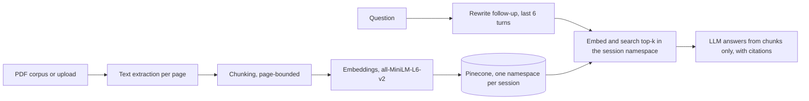

# DocuChat Evidence

RAG app that answers questions over PDFs with citations (file name and page number). Demo mode over arXiv papers, or upload up to 5 PDFs (4 MB each). FastAPI, Pinecone, all-MiniLM-L6-v2 embeddings, Vercel. Includes a RAG vs no-retrieval baseline comparison and separate retrieval and answer metrics.

> Work in progress. This README covers steps 1 and 2 of a 13-step build. Sections marked "planned" are not built yet.

## Status

- [x] 1. Scaffold and project decisions
- [x] 2. Corpus extraction and chunking experiment
- [ ] 3. Embed and index the demo corpus (in progress)
- [ ] 4. Retrieval function and retrieval metrics
- [ ] 5. LLM module and no-retrieval baseline
- [ ] 6. RAG generation with citations
- [ ] 7. RAG vs baseline evaluation
- [ ] 8. FastAPI query endpoint
- [ ] 9. PDF upload with per-session namespaces
- [ ] 10. Multi-turn chat with follow-up rewriting
- [ ] 11. Frontend
- [ ] 12. Deploy, cron cleanup, CI
- [ ] 13. Monitoring, README, screenshots

## Problem

A plain LLM answers from memory, so a reader cannot check where a claim came from, and it has no knowledge of papers published after its training. This project answers from retrieved PDF passages only, and every answer cites the file and page it used. If retrieval finds nothing relevant, the app says so instead of guessing.

The main claim to test is that retrieval improves answers over the same model with no context. Step 7 reports that as a table, with retrieval quality (hit rate or precision@k) kept separate from answer quality (correctness, citation accuracy) so a failure can be traced to the stage that caused it.

## Planned architecture



Only the first three boxes exist so far.

## Repository layout

```
docuchat-evidence/
  src/
    corpus.py            download arXiv PDFs, extract text per page
    chunking.py          page-bounded chunking function
  eval/
    chunk_experiment.py  compares chunking configurations
  data/
    manifest.json        list of downloaded papers (written when download finishes)
    pdfs/                downloaded PDFs (gitignored)
    pages.jsonl          extracted text, one line per page (gitignored)
  api/ public/ screenshots/   empty until later steps
  DECISIONS.md           decisions with reasoning
  .env.example           environment variable names (values are not used until step 3)
  pyproject.toml, uv.lock
```

## Setup

Requires [uv](https://docs.astral.sh/uv/). Commands are for PowerShell on Windows.

```powershell
git clone https://github.com/moshood-abdulganiyu/docuchat-evidence.git
cd docuchat-evidence
uv sync
Copy-Item .env.example .env
```

## Step 2: build the corpus and run the chunking experiment

```powershell
uv run python -m src.corpus download
uv run python -m src.corpus extract
uv run python -m eval.chunk_experiment
```

**Corpus.** `download` queries the arXiv API for the newest papers matching "retrieval augmented generation" and "evaluation" (up to 30), then saves each PDF to `data/pdfs/`. It waits 3 seconds between downloads because arXiv asks for no more than one request per 3 seconds. Papers this recent are a deliberate choice: a model without retrieval is more likely to miss them, which makes the later comparison more informative.

**Extraction.** `extract` reads every PDF with `pypdf`, collapses whitespace, and drops pages with fewer than 50 characters (blank pages, figure-only pages). Each remaining page becomes one line in `data/pages.jsonl` with the file name, page number and text. The page number is the PDF page index, starting at 1, which can differ from the number printed on the page. Citations will use the PDF index so a reader can jump to it in a viewer. The run produced 538 pages.

## Chunking decision

**Strategy.** Fixed-size character windows with overlap, with two rules:

1. A chunk never crosses a page boundary, so every chunk maps to exactly one page and every citation is exact. The cost is that a sentence running across a page break is split.
2. When a window would end mid-sentence, the cut moves back to the last sentence end ("`. `") in the final 40% of the window, if there is one.

**Experiment.** Three configurations on the 538 extracted pages. The experiment measures chunk structure only. It does not measure retrieval quality, because there are no embeddings or questions at this stage.

| Size (chars) | Overlap | Chunks | Mean length | Under 200 chars | Ends mid-sentence |
|---:|---:|---:|---:|---:|---:|
| 500 | 10% | 5,388 | 425 | 1.9% | 20.0% |
| 800 | 10% | 3,332 | 682 | 1.3% | 18.2% |
| 800 | 20% | 3,713 | 688 | 0.3% | 17.1% |

**Reading the table.**

- The last chunk on each of the 538 pages ends at the page boundary, so it counts as mid-sentence in the last column whenever the page does not end on a full stop. That alone accounts for up to 10.0%, 16.1% and 14.5% of the chunks in the three rows. Subtracting it, the avoidable mid-sentence cuts are roughly 10% for 500/10%, 2.1% for 800/10% and 2.6% for 800/20%. The 500-character window is the clear loser on this measure, because its sentence-snapping window is only 200 characters wide.
- 800/20% leaves the fewest tiny fragments (0.3% under 200 characters against 1.3% and 1.9%), because overlap pulls short trailing pieces into a fuller neighbor.
- 800/20% creates 11% more chunks than 800/10% (3,713 against 3,332). That means 11% more embeddings and vectors, which is small at this corpus size.

**Choice (provisional): 800 characters, 20% overlap.** 800 characters is roughly 200 tokens of English prose, which should fit all-MiniLM-L6-v2's 256-token input limit. Math-heavy text produces more tokens per character, so the share of truncated chunks still has to be measured on the real chunks. If more than about 3% exceed 256 tokens, the size drops to 700.

**What will confirm or reverse this.** In step 4 the top two configurations are indexed in separate namespaces and compared on hit rate against a fixed question set. The README will be updated with that result.

## Known limits so far

- Chunk quality is measured by structure only. No retrieval result exists yet.
- Extraction uses `pypdf` text layers. Scanned PDFs without a text layer produce no pages. Two-column layouts can interleave columns, which is not yet checked.
- The corpus is whatever the arXiv query returned on the day it was run, so rerunning later gives a different set. `data/manifest.json` records which papers were used.

## Decisions log

See [DECISIONS.md](DECISIONS.md) for the full list, including the change of embedding approach made during step 3.

## License

MIT. See [LICENSE](LICENSE).