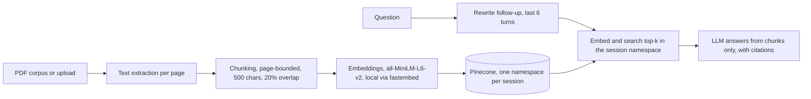

# DocuChat Evidence

RAG app that answers questions over PDFs and cites the file name and page number for every answer. Demo mode runs over 30 recent arXiv papers, or you upload up to 5 PDFs (4 MB each). FastAPI, Pinecone, all-MiniLM-L6-v2 embeddings, Vercel. Includes a RAG vs no-retrieval baseline comparison, with retrieval metrics and answer metrics reported separately.

> Work in progress. This README covers steps 1 to 7. Anything marked "planned" is not built yet. The retrieval and answer results below come from a small question set (17 to 18 questions), so read them as a first measurement, not a benchmark.

## Status

- [x] 1. Scaffold and project decisions
- [x] 2. Corpus extraction and chunking experiment
- [x] 3. Embed and index the demo corpus (6,100 vectors in Pinecone)
- [x] 4. Retrieval function and retrieval metrics
- [x] 5. LLM module and no-retrieval baseline
- [x] 6. RAG generation with citations
- [x] 7. RAG vs baseline evaluation
- [x] 8. FastAPI query endpoint
- [x] 9. PDF upload with per-session namespaces
- [x] 10. Multi-turn chat with follow-up rewriting
- [x] 11. Frontend
- [ ] 12. Deploy, cron cleanup, CI
- [ ] 13. Monitoring, README, screenshots

## Problem

A plain LLM answers from memory, so a reader cannot check where a claim came from, and it knows nothing about papers published after its training. This project answers from retrieved PDF passages only, and every answer cites the file and page it used. If retrieval finds nothing relevant, the app says so instead of guessing.

The main claim to test is that retrieval improves answers over the same model with no context. Step 7 reports that as a table. Retrieval quality (hit rate or precision@k) is kept separate from answer quality (correctness, citation accuracy), so a failure can be traced to the stage that caused it.

## Results so far

Same model (gemini-3.5-flash-lite), same 17 questions, answers scored by hand as correct, abstained or wrong.

| System | Correct | Abstained | Wrong |
|---|---:|---:|---:|
| No retrieval | 0/17 | 16/17 | 1/17 |
| RAG | 11/17 | 6/17 | 0/17 |

| Stage | Result |
|---|---|
| Retrieval, gold page in the top 5 (step 4, 18 questions) | 16/18 (0.89) |
| Answers correct, RAG (17 questions) | 11/17 (0.65) |
| Citation on the gold page, answered RAG rows | 11/11 |

Details, limits and how the scoring was done are in step 7 below.

## Architecture



Built so far: the boxes from the PDF corpus through Pinecone (demo namespace only), embed and search top-k in the namespace (step 4), and the LLM answering from the retrieved chunks with citations (steps 5 and 6, single-turn). Planned: follow-up rewriting, per-session namespaces for uploads, and the API and frontend around all of it.

## Technology choices

| Tool | Purpose | Why |
|---|---|---|
| FastAPI + Pydantic | API with typed request and response models | Automatic docs at `/docs`, validation at the boundary Built in step 8. Typed models, validation at the boundary, docs at /docs |
| pypdf | Text extraction per page | Pure Python, runs inside a serverless function, gives page numbers directly |
| fastembed (all-MiniLM-L6-v2, ONNX) | Embeddings, 384 dimensions, run locally | Hugging Face Inference returned 402 (no credits) and Gemini embeddings hit the free cap of 1,000 requests per day, counted per text, which cannot index 6,100 chunks or serve uploads. One model for demo and uploads |
| Pinecone serverless | Vector store, index `docuchat`, 384 dimensions, cosine | Namespaces give per-session isolation without running a database |
| gemini-3.5-flash-lite (google-genai) | LLM for RAG and the baseline, behind one module `src/llm.py` | Free tier. One file to change if the provider changes. gemini-2.5-flash was the first choice and returned 404 ("no longer available to new users") on 2026-10-15. gemini-3.8-flash was not used because its free quota is reported at about 20 requests per day, and the evaluation needs 36 or more calls |
| uv | Dependencies and lockfile | Reproducible installs from `uv.lock` |
| Vercel | Deployment and cron cleanup | Planned, step 12 |

The embedding change and the LLM model change from the original brief are recorded in [DECISIONS.md](DECISIONS.md).

## Repository layout

```
docuchat-evidence/
  src/
    corpus.py            download arXiv PDFs, extract text per page
    chunking.py          page-bounded chunking: chunk_page(text, size, overlap_pct)
    embeddings.py        embed(texts, kind="document" | "query"), normalized vectors
    store.py             get_index(): Pinecone index handle
    index_corpus.py      chunk, embed and upsert the demo corpus; --limit N, --check "question"
    retrieve.py          top-k retrieval from a namespace
    llm.py               generate(prompt, system=None): the only file that imports google-genai
    rag.py               rag_answer(question, namespace, k): retrieve, answer from chunks, cite
    models.py            Pydantic request and response models
    app.py               FastAPI app: GET /health, POST /query
  eval/
    chunk_experiment.py  compares chunking configurations by structure
    token_check.py       counts MiniLM tokens per chunk against the 256-token limit
    questions.jsonl      18 questions with gold file, gold page and, for some, answer_patterns
    retrieval_eval.py    hit rate at k=3 and k=5
    sample_passages.py   samples passages to write questions from
    baseline.py          no-retrieval answers for every question
    baseline_answers.jsonl
    rag_answers.py       RAG answers for every question, with retrieved ids and scores
    rag_answers.jsonl
    diagnose_notfound.py reruns the "not found" questions and records why
    diagnose_refusals.py checks whether answer strings are in the retrieved chunks
    recite.py            recomputes citations in rag_answers.jsonl without model calls
    make_sheet.py        builds scoring_sheet.csv from the questions and both answer files
    auto_score.py        marks answers and citations that contain the gold string
    finish_scores.py     applies hand judgments and prints the answer metrics
    scoring_sheet.csv    the scored results, one row per question
  data/
    manifest.json        list of downloaded papers (committed)
    pdfs/                downloaded PDFs (gitignored)
    pages.jsonl          extracted text, one line per page (gitignored)
    model_cache/         embedding model files (gitignored)
  api/
    index.py             Vercel entry point, re-exports app from src/app.py
  tests/
    test_api.py          12 API tests, no network (rag_answer is faked)
  DECISIONS.md           decisions with reasoning
  .env.example           environment variable names
  pyproject.toml, uv.lock
```

## Setup

Requires Python 3.12 and [uv](https://docs.astral.sh/uv/). Commands are for PowerShell on Windows.

```powershell
git clone https://github.com/moshood-abdulganiyu/docuchat-evidence.git
cd docuchat-evidence
uv sync
Copy-Item .env.example .env
```

Fill in `.env`:

| Variable | Used for |
|---|---|
| `PINECONE_API_KEY` | Pinecone access |
| `PINECONE_INDEX` | Index name, `docuchat` |
| `GEMINI_API_KEY` | LLM calls (step 5 onward) |
| `LLM_MODEL` | `gemini-3.5-flash-lite` |

Create the Pinecone index once (384 dimensions, cosine):

```powershell
uv run python -c "from pinecone import Pinecone, ServerlessSpec; import os; from dotenv import load_dotenv; load_dotenv(); pc = Pinecone(api_key=os.environ['PINECONE_API_KEY']); pc.create_index(name='docuchat', dimension=384, metric='cosine', spec=ServerlessSpec(cloud='aws', region='us-east-1')); print(pc.describe_index('docuchat'))"
```

## Step 2: build the corpus and run the chunking experiment

```powershell
uv run python -m src.corpus download
uv run python -m src.corpus extract
uv run python -m eval.chunk_experiment
```

**Corpus.** `download` queries the arXiv API for the newest papers matching "retrieval augmented generation" and "evaluation" (up to 30) and saves each PDF to `data/pdfs/`. It waits 3 seconds between downloads because arXiv asks for no more than one request per 3 seconds. The exact papers are listed in `data/manifest.json`. Recent papers are a deliberate choice: a model without retrieval is more likely to miss them, which makes the later comparison more informative.

**Extraction.** `extract` reads every PDF with `pypdf`, collapses whitespace, and drops pages with fewer than 50 characters (blank pages, figure-only pages). Each remaining page becomes one line in `data/pages.jsonl` with the file name, page number and text. The run produced 538 pages. The page number is the PDF page index starting at 1, which can differ from the number printed on the page. Citations use the PDF index so a reader can jump to it in a viewer.

## Chunking decision

**Strategy.** Fixed-size character windows with overlap, with two rules:

1. A chunk never crosses a page boundary, so every chunk maps to exactly one page and every citation is exact. The cost is that a sentence running across a page break is split.
2. When a window would end mid-sentence, the cut moves back to the last sentence end ("`. `") in the final 40% of the window, if there is one.

**Experiment 1: chunk structure.** Four configurations on the 538 extracted pages. This measures chunk shape only, not retrieval quality.

| Size (chars) | Overlap | Chunks | Mean length | Under 200 chars | Ends mid-sentence |
|---:|---:|---:|---:|---:|---:|
| 500 | 10% | 5,388 | 425 | 1.9% | 20.0% |
| 500 | 20% | 6,100 | 427 | 1.2% | 19.4% |
| 800 | 10% | 3,332 | 682 | 1.3% | 18.2% |
| 800 | 20% | 3,713 | 688 | 0.3% | 17.1% |

The last chunk on each page ends at the page boundary, so it counts as mid-sentence whenever the page does not end on a full stop. That accounts for at most 10.0%, 8.8%, 16.1% and 14.5% of the chunks in the four rows. The avoidable mid-sentence rate is therefore at least 10.0%, 10.6%, 2.1% and 2.6%. On this measure 800/20% looked best, and it was chosen provisionally.

**Experiment 2: token limit.** all-MiniLM-L6-v2 reads at most 256 tokens. The first choice assumed 800 characters is about 200 tokens. Counting tokens with the model's own tokenizer on every chunk showed otherwise, because equations, tables and reference lists use more tokens per character than prose.

| Size (chars) | Overlap | Chunks | Mean tokens | 95th percentile | Max | Over 256 tokens |
|---:|---:|---:|---:|---:|---:|---:|
| 500 | 20% | 6,100 | 113 | 191 | 377 | 77 (1.3%) |
| 600 | 20% | 5,039 | 136 | 226 | 452 | 156 (3.1%) |
| 700 | 20% | 4,256 | 159 | 265 | 527 | 253 (5.9%) |
| 800 | 20% | 3,713 | 181 | 299 | 602 | 418 (11.3%) |

Text past the 256-token limit is not represented in the vector, so those chunks cannot be retrieved by their tail. The gate was 3% of chunks over the limit. 800 fails at 11.3%, and the planned fallback of 700 also fails at 5.9%. 600 misses by 0.1 points.

**Choice: 500 characters, 20% overlap.** It is the largest size that passes the 3% gate. The cost is 6,100 vectors instead of 3,713, and at least 10.6% avoidable mid-sentence cuts against 2.6% for 800/20%, because the sentence-snapping window is only 200 characters wide.
**What will confirm or reverse this.** The planned 600/20% comparison was not run. With 18 questions one question is 5.6 points, too coarse to separate two sizes that differ by about 1 to 2 questions. 500/20% stays, on the token-limit result above. Step 4 reports hit rate for 500/20% only (see below).

## Step 3: embed and index the demo corpus

```powershell
uv run python -m src.index_corpus
uv run python -m src.index_corpus --check "How is retrieval quality evaluated in RAG systems?"
```

Each page is chunked at 500 characters with 20% overlap. Each chunk gets the id `file:pPAGE:cIDX` and is embedded locally, then upserted in batches of 64 into the namespace `demo` with metadata: file, page, chunk index and text. The first run downloads the model into `data/model_cache/`. Pinecone reports 6,100 vectors, 384 dimensions, cosine, matching the chunk count.

`--check` embeds a question as a query and prints the top 3 hits with score, file and page. It is a smoke test, not a metric. Hit rate comes in step 4.

To rerun the token check, find the tokenizer file and pass its path:

```powershell
Get-ChildItem data\model_cache -Recurse -Filter tokenizer.json | Select-Object -First 1 -ExpandProperty FullName
uv run python -m eval.token_check "<path to tokenizer.json>"
```

To re-index after changing the chunk size, delete the old vectors first so old ids do not sit beside the new ones:

```powershell
uv run python -c "from src.store import get_index; get_index().delete(delete_all=True, namespace='demo')"
uv run python -m src.index_corpus
```

## Step 4: retrieval and hit rate

```powershell
uv run python -m src.retrieve "How is retrieval quality evaluated in RAG systems?" -k 5
uv run python -m eval.retrieval_eval
```

`src/retrieve.py` embeds the question as a query and returns the top-k chunks from a Pinecone namespace (the namespace is a parameter, for step 9). `eval/questions.jsonl` holds 18 questions, each written from a passage sampled from a different paper (`eval/sample_passages.py`, seed 7, reference-list pages skipped).

A hit means a retrieved chunk is from the gold file and a gold page. Gold pages are every page of the gold paper that contains the answer string (`answer_patterns`), because headline facts repeat in the abstract, introduction, results and tables. For one question (q13) the contents page was excluded.

| Run | k=3 file+page | k=5 file+page | file only (k=3 and 5) |
|---|---:|---:|---:|
| First run, one gold page per question | 10/18 (0.56) | 11/18 (0.61) | 17/18 (0.94) |
| Gold pages from answer strings | 15/18 (0.83) | 16/18 (0.89) | 17/18 (0.94) |

The change between the two rows is a labelling fix, not a retrieval improvement. Five questions (q02, q05, q07, q13, q14) gained extra valid pages after I read the first-run misses. That can only raise the score, so both rows are reported.

Misses at k=5: q01 (answer is an affiliation line, no chunk from the paper returned) and q06 (right paper, but the top 5 chunks came from other pages; the p4 chunk naming the model was not returned). q04 hits only at rank 5.

Limits of this number: 18 questions, so one question is 5.6 points; a hit means the right page was returned, not that the returned chunk contains the answer; the questions were written by one person. Step 6 found a concrete case of the second limit (q13, below).

## Step 5: LLM module and no-retrieval baseline

```powershell
uv run python -m eval.baseline
```

`src/llm.py` holds one function, `generate(prompt, system=None)`. It calls the model named in `LLM_MODEL` at temperature 0 and retries rate-limit and server errors (429, 500, 503) with a delay that starts at 5 seconds and doubles, up to 4 retries. No other file imports google-genai, so a provider change touches this file only.

`eval/baseline.py` sends each of the 18 questions to the model with no context. The system prompt asks for a direct, concise answer from the model's own knowledge, and to say it does not know when it does not. Each answer is saved to `eval/baseline_answers.jsonl` with the question id, question, answer, model name and timestamp. The script waits 7 seconds between calls and skips ids that are already saved, so a rate-limit stop can be resumed by running it again.

A baseline that says "I do not know." is behaving correctly for papers newer than its training data. Step 7 therefore scores each answer as correct, abstained or wrong, so that abstaining is not counted as a wrong guess.

## Step 6: RAG generation with citations

```powershell
uv run python -m src.rag "How is retrieval quality evaluated in RAG systems?"
uv run python -m eval.rag_answers
```

`src/rag.py` has `rag_answer(question, namespace="demo", k=5)`:

1. Retrieve the top 5 chunks and drop any scoring under `MIN_SCORE` (0.2, not calibrated). If none are left, return "Not found in the documents." without calling the model, with `reason` set to `gate`.
2. Otherwise number the remaining chunks `[1]` to `[5]` in the prompt, each with its file and page. The system prompt allows only the passages as a source, requires a passage number after every claim, and requires the exact reply `NOT_FOUND` when the passages do not contain the answer. That reply is recorded with `reason` set to `model`. An empty reply is recorded as `empty`.
3. The code reads the cited numbers (forms `[1]`, `[1][3]` and `[1, 5]`) and maps each to a file and page, one entry per distinct page. A number outside the range is recorded as `invalid_citations`, and an answer with no numbers is flagged `uncited`.

Citing by number means the model cannot invent a file name or page: the citation list comes from the chunks it was shown. A first version of the parser missed the `[1, 5]` form and listed a page twice when two chunks came from it. Both were fixed, and the saved answers were recomputed offline with `eval/recite.py`.

`eval/rag_answers.py` runs the same 18 questions and saves each result to `eval/rag_answers.jsonl` with the answer, citations and the retrieved ids, files, pages and scores, so retrieval and answers can be scored separately.

**Smoke tests (one question each, not a calibration).**

| Question | Top 5 scores | Result |
|---|---|---|
| How is retrieval quality evaluated in RAG systems? | 0.602 to 0.649 | Cited answer, [3] = 2610.02926v1.pdf p.8 |
| What is the best recipe for jollof rice? | 0.247 to 0.290 | "Not found in the documents." |

The off-topic scores are above the 0.2 gate, so that refusal came from the model's `NOT_FOUND` reply, not from the score gate. The gate did nothing in this test.

**Why six questions came back "not found".** The first run gave 12 answers and 6 refusals out of 18 questions (q01, q03, q06, q07, q13, q16). Rerunning those six with the `reason` field (`eval/diagnose_notfound.py`) showed that all six were `model` refusals: every one had 5 of 5 chunks above the score gate (top-5 scores 0.491 to 0.730), and none answered on the rerun. The score gate was not the cause. `eval/diagnose_refusals.py` then checked whether the gold answer string was in the retrieved chunks:

| Question | What the check found |
|---|---|
| q01 | Gold paper not retrieved at all (a step 4 miss). Refusal is correct. |
| q06 | Gold file in all 5 chunks, but the answer phrase is in none (a step 4 miss). Refusal is correct. |
| q13 | Gold pages 8 and 20 returned, but none of the three model names is in any chunk. Step 4 counted this as a hit. Refusal is correct. |
| q07 | The answer string 0.798 is in a retrieved chunk and the model still refused. Cause not found. |
| q03, q16 | No answer string recorded, so the check could not run. Cause not found. |

So 3 of the 6 refusals are correct (the answer never reached the model), and 3 are unexplained. I stopped the diagnosis there and did not change the prompt.

## Step 7: RAG vs no-retrieval baseline

Same model, same questions, scored on 17 questions. q05 is excluded: its question is ambiguous, because the paper's no-retrieval table row for the 8B Llama model has five values and the abstract ties one of them to the multi-domain evaluation.

| System | Correct | Abstained | Wrong |
|---|---:|---:|---:|
| No retrieval | 0/17 | 16/17 | 1/17 |
| RAG | 11/17 | 6/17 | 0/17 |

Retrieval and answers are reported separately:

| Stage | Result |
|---|---|
| Retrieval, gold page in the top 5 (18 questions) | 16/18 (0.89) |
| Answers correct, RAG (17 questions) | 11/17 (0.65) |
| Citation on the gold page, answered RAG rows | 11/11 |

The gap between 0.89 retrieval and 0.65 correct answers is the 6 refusals described in step 6. RAG gave no wrong answers. The baseline gave one wrong answer (q09) and abstained on the rest.

**How the scoring was done.** `eval/make_sheet.py` builds `eval/scoring_sheet.csv` with every "I do not know" baseline answer and every RAG "not found" prefilled as abstained. `eval/auto_score.py` marked a RAG answer correct when it contained the gold answer string, and a citation as good when the cited page's text did. That covered 2 of the 11 answered rows (q02, q14). The other 9 answers were judged by hand against the cited page, and `eval/finish_scores.py` applied the judgments and printed the table. The baseline answer for q09 was also judged by hand.

**How to read this.**
- The baseline abstained on 16 of 17 because the questions name specific recent papers it cannot know. The table shows that retrieval lets the model answer at all. It does not show that retrieval beats a model that already knows the topic.
- Citation accuracy means the cited page is the page the question was written from. That is weaker than checking every claim in the answer.
- 17 questions, so one question is 5.9 points. One person wrote the questions and scored the answers.
- Both systems use gemini-3.5-flash-lite, a small model. A larger model may know more without retrieval.


## Step 8: query API

```powershell
uv run uvicorn src.app:app --reload
```

Open http://127.0.0.1:8000/docs for the interactive docs.

| Endpoint | Purpose |
|---|---|
| `GET /health` | Returns `{"status": "ok"}` |
| `POST /query` | Body: `question` (1 to 500 characters, whitespace trimmed), `k` (1 to 10, default 5). Returns `answer`, `found`, `reason`, `citations` (`n`, `file`, `page`), `uncited`, `retrieved` (`id`, `score`, `file`, `page`) |

`/query` calls `rag_answer` on the `demo` namespace. The namespace is fixed on the server and is not a request field. Upload sessions arrive in step 9.

Errors: invalid input returns 422. A Gemini rate limit (status 429) returns 503 with a short message. Any other failure returns 502 with a generic message. The full exception goes to the server log only.

Tests: `uv run pytest -q` runs 12 tests (health, found, not found, parameters passed through, 6 validation cases, both error mappings). They fake `rag_answer`, so they check the API layer only. Retrieval and answer quality are measured by the eval scripts, not by these tests. Lint: `uv run ruff check .` and `uv run ruff format --check .` both pass on 29 files.


## Step 9: upload and sessions

| Endpoint | Purpose |
|---|---|
| `POST /upload` | Multipart: `file` (one PDF), optional `session_id`. Creates a session on first upload and returns its id. |
| `POST /query` | Optional `session_id`. With it, the question is answered from that session only. Without it, from the demo corpus. |

Limits: 4 MB per file, 5 files per session, one file per request, at most 800 chunks per file (a guess to bound embedding time). Files are parsed in memory and never written to disk. Session ids look like `sess_<unix_timestamp>_<16 hex chars>` and each session is its own Pinecone namespace. Queries never use a filter; isolation is by namespace only. Scanned PDFs without a text layer are rejected.

**Privacy notice:** the text of uploaded PDFs is stored as vectors in Pinecone and sent to Google (Gemini) to answer questions. On the free tier, Google may use inputs to improve its products. Do not upload confidential documents.

## Step 10: follow-ups

`POST /query` accepts `history`: up to 20 messages (`role` user or assistant, `content` up to 2,000 characters). The server keeps the last 6, rewrites the question into a standalone one with the same model (`src/rewrite.py`), and uses the rewritten question for retrieval and answering. The response includes `rewritten_question`. With no history, no rewrite call is made. If the rewrite call fails, the original question is used. Follow-up quality is not measured yet.

## Step 11: frontend

Static page in `public/` (`index.html`, `style.css`, `app.js`, no framework). Locally FastAPI serves it at `/`. Chat thread, citations panel, upload box with a progress bar, demo/My PDFs toggle, mic input (Web Speech API) and read-aloud (speech synthesis). The browser sends the last 6 messages as `history` and keeps the session id in `sessionStorage`, so a new tab starts a new session. Answers are rendered as plain text.

Voice limits: the mic button appears only in browsers that support the Web Speech API (Chrome and Edge). In Chrome, the audio is processed by the browser vendor's speech service, not by this app. Read-aloud voices depend on the operating system. Not tested on mobile.

## Known limits so far

- The answer results rest on 17 questions scored by one person (see step 7). Retrieval hit rate is on 18 questions.
- 6 of 17 RAG answers were refusals. 3 are explained (answer text not in the retrieved chunks) and 3 (q03, q07, q16) are not.
- Page-level hit rate overstates how often the answer reaches the model: q13 counted as a hit although no retrieved chunk contained the answer.
- `MIN_SCORE` is 0.2 and uncalibrated. In one off-topic test the top scores were 0.247 to 0.290, so the gate did not filter that question. It filtered none of the 18 evaluation questions.
- The baseline comparison is weak by design: the questions name papers a model cannot know without retrieval.
- Both systems use a small model, gemini-3.5-flash-lite.
- `pypdf` drops spaces and splits hyphenated words on some pages (retrieved passages showed "factualgrounding", "fortesting" and "guide- lines"). Not yet quantified or fixed. Changing extraction means re-indexing.
- Two-column layouts can interleave columns. Not yet checked, and likely common in arXiv papers.
- Scanned PDFs without a text layer produce no pages.
- The corpus is whatever the arXiv query returned on the day it was run. `data/manifest.json` records which papers were used.
- Google may use free-tier Gemini inputs to improve its products. The upload box and the final README will carry a notice that uploaded text is sent to Google (steps 9 and 13).
- Gemini free-tier limits are shown only in AI Studio and change; gemini-2.5-flash stopped being available to new users on 2026-10-15. Not yet verified: Vercel bundle size and cold start with onnxruntime and the model file, Vercel body size and timeout limits, Pinecone free-tier limits. All checked against current docs at steps 8 and 12.
- pypdf glues table cells together ("0.7790.594", "86.4098.15100.00"), so numeric tables embed and match poorly.
- Some pages contain garbled characters ("•", "Query→Top-k"). Cause not yet found (PDF or extraction).
- Reference-list pages are indexed and can take top-k slots (seen once in a smoke test). Not measured as a cause of any miss here.
- `/query` has no rate limiting or authentication. Anyone with the URL can use the Gemini free quota.
- A rate-limited request can wait up to 75 s inside `llm.py` retries (5 + 10 + 20 + 40 s) before the API answers 503. Not yet checked against Vercel's function timeout.
- Error mapping reads a `.code` attribute on the exception. It depends on how google-genai reports errors.
- The question limit (500 characters) and k limit (10) are guesses, not tuned.

## Decisions log

See [DECISIONS.md](DECISIONS.md) for the full list, including the embedding change, the chunk size change, the LLM model change and the evaluation choices.

## License

MIT. See [LICENSE](LICENSE).
